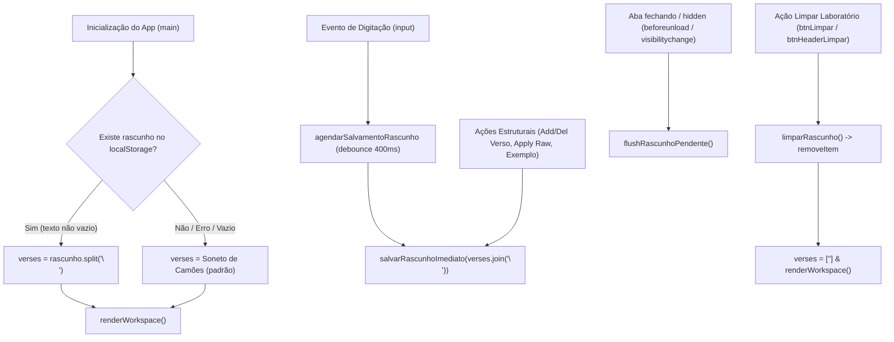

# Especificação Técnica: Persistência do Poema Atual no LocalStorage

**Ticket:** #20  
**Branch:** `feat/20-persistir-poema-no-localstorage`  
**Escopo:** `site/app.js`, `docs/specs/20-persistir-poema-atual-no-localstorage.md`, testes de conformidade em `tests/wasm_api.rs`

---

## 1. Contexto e Motivação

Atualmente, o estado dos versos em edição no Lírica reside unicamente em memória no array `verses` dentro do runtime JavaScript da aba.
Caso a pessoa usuária:
1. Recarregue a página (`F5` / `Ctrl+R`);
2. Navegue para outra página (como `ajuda.html` ou documentação) e retorne;
3. Feche acidentalmente a aba ou o navegador móvel mate a página em segundo plano;

Todo o progresso de edição poética é irremediavelmente perdido, voltando a exibir o soneto inicial padrão de Camões.

---

## 2. Árvore de Decisão Técnica e Alternativas Descartadas

Para a Natasha entender os motivos das escolhas sem contexto prévio:

1. **Por que `localStorage` e não `sessionStorage`?**
   - *Alternativa descartada:* `sessionStorage`.
   - *Motivo do descarte:* O `sessionStorage` é limpo assim que a aba é fechada. No caso de navegação para `ajuda.html` em nova aba ou fechamento acidental da aba no mobile, os dados seriam perdidos. O `localStorage` persiste entre abas e sessões.
2. **Por que `localStorage` e não `IndexedDB` ou OPFS?**
   - *Alternativa descartada:* `IndexedDB` / Cache API / OPFS.
   - *Motivo do descarte:* *Overengineering* injustificável. Um poema típico varia entre 50 bytes e 15 KB de texto. O `localStorage` síncrono com debounce atende com folga o limite de 5 MB dos navegadores modernos sem complexidade de transações assíncronas.
3. **Por que texto plano com quebras de linha (`\n`) em vez de JSON?**
   - *Alternativa descartada:* `JSON.stringify(verses)`.
   - *Motivo do descarte:* `verses.join('\n')` produz exatamente o mesmo formato raw aceito pelo editor livre e pelo motor WebAssembly (`carregarPoema(raw)`). Reduz overhead de serialização e permite inspeção direta humana no DevTools.
4. **Por que debounce de 400ms em vez de gravação a cada tecla?**
   - *Alternativa descartada:* Gravação imediata a cada evento `input`.
   - *Motivo do descarte:* `localStorage.setItem` é uma operação síncrona de I/O em disco no thread principal. Salvar a cada tecla causa micro-engasgos (*jank*) de digitação, especialmente no mobile. Um debounce de 400ms equilibra fluidez de 60fps com persistência confiável.
5. **Por que flush síncrono em `beforeunload` e `visibilitychange`?**
   - Se o usuário digitar um caractere e fechar a aba em 200ms (antes do debounce de 400ms disparar), o listener de `beforeunload` ou `visibilitychange` força a execução imediata do salvamento pendente, garantindo zero perda de dados.
6. **Por que `try / catch` defensivo obrigatório em todas as chamadas de storage?**
   - Modos de navegação anônima restritos (ex.: Safari com *Block All Cookies* ou Firefox Strict) e dispositivos com disco cheio disparam `SecurityError` ou `QuotaExceededError`. O app não pode quebrar se o storage falhar.

---

## 3. Contrato Técnico e Nomenclatura Canônica

- **Chave do Storage:** `'lirica_draft_poem'`
- **Tempo de Debounce:** $400\text{ms}$
- **Funções Canônicas:**
  - `salvarRascunhoImediato(texto)`: Executa `try { localStorage.setItem(STORAGE_KEY, texto) } catch (e) { ... }`.
  - `agendarSalvamentoRascunho(texto)`: Cancela timeout anterior via `clearTimeout` e agenda execução em 400ms.
  - `flushRascunhoPendente()`: Se houver timer pendente, cancela-o e executa a gravação imediatamente.
  - `recuperarRascunho()`: Retorna o rascunho persistido via `localStorage.getItem(STORAGE_KEY)` ou `null`.
  - `limparRascunho()`: Remove a chave via `localStorage.removeItem(STORAGE_KEY)`.

---

## 4. Diagrama de Fluxo e Ciclo de Vida

---

## 5. Critérios de Aceite e Verificação

1. **Restauração Transparente:**
   - Ao digitar qualquer verso e recarregar a página, o texto recarregado deve ser idêntico ao digitado.
2. **Respeito ao Reset:**
   - Ao acionar "Limpar", o rascunho deve ser removido do `localStorage` para que recargas subsequentes voltem com a tela limpa (ou com o padrão se vazio).
3. **Persistência Imediata em Mudanças Estruturais:**
   - Troca via "Modo Texto Livre" (`btnApplyRaw`), inserção de versos (`Enter`/`Shift+Enter`), exclusão de versos (`btnDel`) ou escolha de exemplo devem persistir o novo conteúdo de imediato.
4. **Isolamento de Erros:**
   - Se `localStorage` for inacessível ou lançar exceção, o Lírica deve registrar aviso discreto no console (`console.warn`) e continuar funcionando normalmente em memória.
5. **Cobertura Automatizada:**
   - Teste de contrato em `tests/wasm_api.rs` garantindo presença da chave canônica, debounce, tratamento defensivo com `try/catch` e registro de eventos de ciclo de vida.
